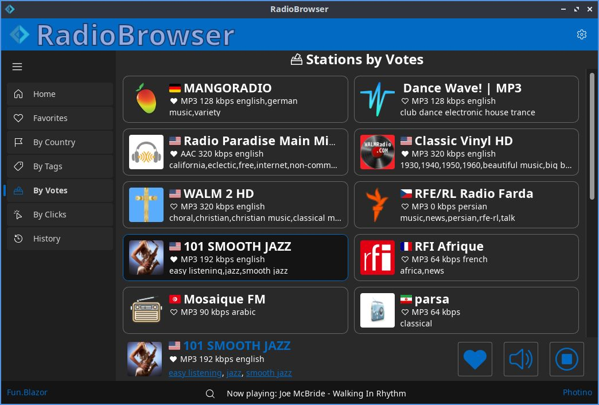

# RadioBrowser Player

A desktop internet radio player built with F# and .NET 10. Browse stations from the [RadioBrowser](https://www.radio-browser.info/) directory, save favorites, and keep track of what you have listened to.

[](https://dotnet.microsoft.com/)
[](https://fsharp.org/)
[](https://opensource.org/licenses/MIT)



## Features

- Browse popular stations by votes or clicks, or explore stations by country and tag.
- Search stations by name and filter the station lists.
- Play internet radio streams with playback and volume controls.
- Add stations to favorites and review listening history.
- View track metadata when it is provided by the station.
- Search for and download tracks through the available downloader plugin.
- Switch between light and dark themes and choose an accent color.

Favorites and listening history are stored locally in a LiteDB database.

## Installation

Download the latest release from the [Releases](https://github.com/poimenov/RadioBrowser/releases) page, choose the archive for your platform, and extract it.

- **Self-contained** archives include the .NET runtime.
- **Framework-dependent** archives require the .NET 10 runtime to be installed.

Keep the extracted files together when running the app; the release includes a `Plugins` folder used by the downloader.

Prebuilt release packages are currently produced for Windows x64 and Linux x64. macOS is not included in the release build script.

## Build and run from source

### Prerequisites

- [.NET 10 SDK](https://dotnet.microsoft.com/download/dotnet/10.0)

### Commands

From the repository root:

```bash
dotnet restore RadioBrowser.slnx
dotnet build RadioBrowser.slnx --configuration Release
dotnet run --project src/RadioBrowser/RadioBrowser.fsproj
```

Run the test suite with:

```bash
dotnet test tests/RadioBrowser.Tests/RadioBrowser.Tests.fsproj
```

To create release archives for Windows x64 and Linux x64, run:

```bash
dotnet fsi publish.fsx
```

The publishing script creates framework-dependent and self-contained archives under `artifacts/`. It removes existing `bin/`, `obj/`, and `artifacts/` directories before building.
